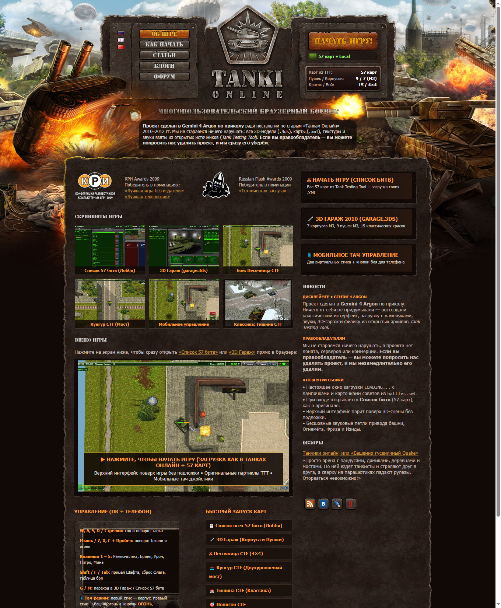
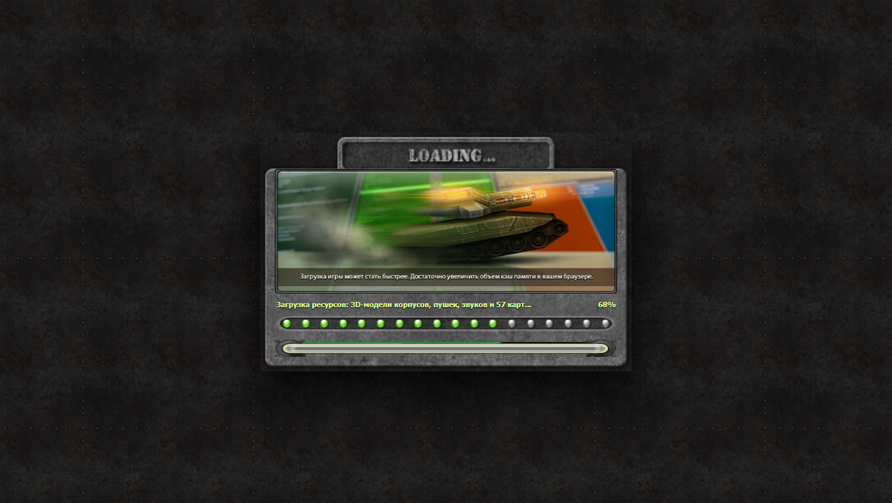
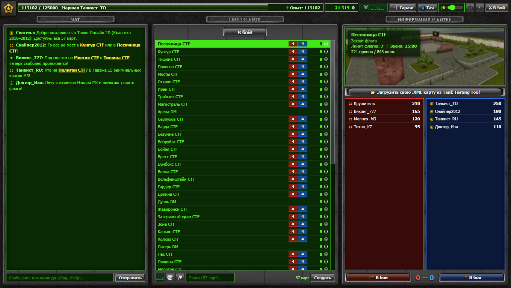
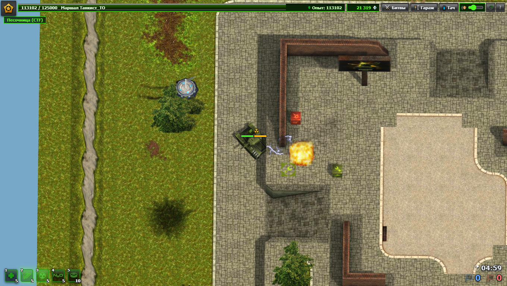
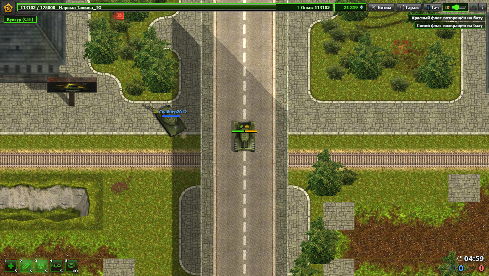
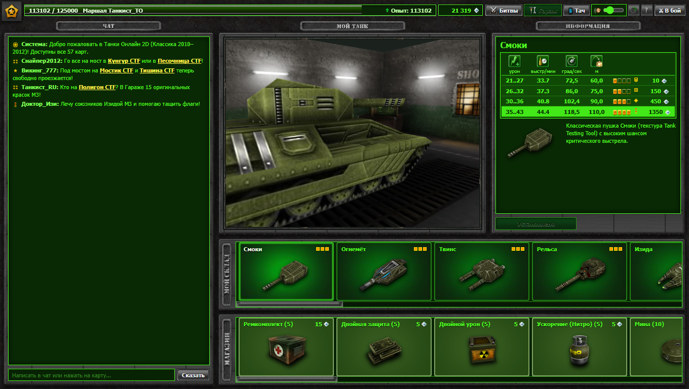
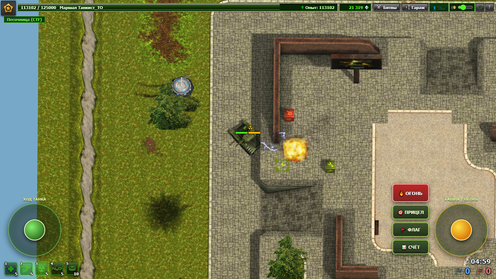

# 🛡️ ТАНКИ ОНЛАЙН 2.5D — Классика 2010–2012
### *«Многопользовательский браузерный боевик • Башенно-гусеничный Quake»*

[-tanki__2d.html%23garage-2563eb?style=for-the-badge&logoColor=white)](./tanki_2d.html#garage)

---

> [!IMPORTANT]
> ### ⚠️ Дисклеймер / О проекте (Прочитайте!)
> **Этот проект сделан в `Gemini 4 Argon` чисто по приколу (`just for fun`), из ностальгии по старым добрым «Танкам Онлайн» 2010–2012 годов.**
> - **Мы ничего от себя не придумывали** — специально старались воссоздать точь-в-точь тот самый олдскульный интерфейс, звуки, партиклы, гараж и веб-портал `tankionline.com` образца 2010 года.
> - **Мы не стараемся ничего нарушать и не преследуем никакой коммерческой выгоды.** Все 3D-модели (`.3ds`, `.tara`), текстуры, спрайт-листы эффектов, звуки и `.xml`-карты взяты исключительно из **открытых источников** (`Tank Testing Tool`, публичные фанатские архивы старых версий и `Wayback Machine`).
> - **Уважаемые правообладатели (`AlternativaPlatform` / ООО «Танки Онлайн»):** если вы являетесь правообладателем и считаете, что размещение данного фанатского ретро-проекта нарушает ваши права, **вы можете просто попросить нас удалить его** — мы с уважением и без вопросов удалим репозиторий по первому обращению.

---

## 🏆 Легенда 2009–2012 годов в одном браузерном окне

> *«Игроки сражаются на онлайновых аренах, зарабатывая кристаллы и продвигаясь вверх по карьерной лестнице. Просто арена с пандусами, домиками, деревцами и мостами. По ней ездят танкисты и стреляют друг в друга, а сверху на парашютиках падают рулезы. Башенно-гусеничный Quake!»*
> — **Из описания на главной странице `tankionline.com/ru/`, март 2010 г.**

| Награда КРИ Awards 2009 | Russian Flash Awards 2009 | Движок и ассеты |
| :--- | :--- | :--- |
| 🏅 **«Лучшая игра без издателя»** 🏅 **«Лучшая технология»** | 🏆 **Победитель в номинации** **«Техническая заслуга»** | ⚙️ **Оригинальные `.3ds` / `.tara` / `.xml`** из `Tank Testing Tool` + `Three.js WebGL` |

---

## 📸 Скриншоты проекта

### 🌐 Олдскульный веб-портал `tankionline.com` образца 2010 года ([`index.html`](./index.html))

| ⏳ Оригинальное окно загрузки `LOADING...` (`battles.swf`) | 📋 Вход сразу в «Список битв» (57 карт + Чат) |
| :---: | :---: |
|  |  |
| **⚔️ Бой на «Песочнице CTF» (Партиклы TTT + 3D мины)** | **🌉 Двухуровневый мост на «Кунгуре CTF»** |
|  |  |
| **🔧 Гараж 2010–2011 (`garage.3ds` + `garage.jpg`)** | **📱 Мобильное управление (Два виртуальных стика + кнопки)** |
|  |  |

---

## 🔥 Что реализовано в проекте (100% Олдскул без отсебятины и фейковых кнопок)

### 1. 🌐 Олдскульный сайт `tankionline.com` образца 2010 года ([`index.html`](./index.html))
- Воссоздана та самая главная страница старого сайта **«Танки Онлайн» 2010 года** на основе архивной вёрстки и оригинальной графики из `Wayback Machine` **без выдуманного онлайна, фейковых серверов, новостей или доната**.
- Фирменная большая кнопка **«Начать игру»**, честная сводка контента (`7 корпусов | 9 пушек | 57 карт | 15 красок`), дисклеймер **Gemini 4 Argon**, быстрый переход сразу в бой, 3D Гараж, мобильный режим или на любую карту.

### 2. 📱 Сенсорное мобильное управление и верхний HUD поверх игры без подложки
- **Верхний интерфейс (`#top-hud`) парит прямо поверх 3D-сцены боя без глухой подложки**, а холст боя разворачивается на все `100vw × 100vh`.
- Убраны все неработающие элементы (кнопка покупки кристаллов за донат `[x2 Купить]`, фейковый выход из аккаунта `[X]`, фейковая ссылка на сервер и неработающая кнопка `Улучшить`).
- **Полноценное управление с телефона и планшета (`📱 Тач`):**
  - **Левый виртуальный стик (`ХОД ТАНКА`)** — плавный газ, задний ход и поворот корпуса.
  - **Правый виртуальный стик (`БАШНЯ / ОГОНЬ`)** — наведение башни на 360° и автоматический огонь при отклонении стика до края.
  - **Сенсорные кнопки боя:** `🔥 ОГОНЬ`, `🎯 ПРИЦЕЛ` (снайперский прицел Шафта), `🚩 ФЛАГ` (сброс флага), `📊 СЧЁТ` (таблица боя) и нажатие пальцем по иконкам припасов `1–5`.

### 2. 💥 Оригинальные партиклы, спрайт-листы и звуки из `Tank Testing Tool` и `battles.swf`
- Все боевые эффекты достаются напрямую из раскадровок `Tank Testing Tool`:
  - **Смоки M3:** дульная вспышка `smoky_shot`, 17-кадровый взрыв `smoky_explosion` с клубами тёмного дыма и 8-кадровый электрический разряд критического удара `smoky_crit`.
  - **Гром M3:** дульное пламя `thunder_shot`, 29-кадровый огненно-дымовой взрыв `thunder_explosion` со сплэш-уроном и декалями копоти на стенах.
  - **Рельса M3:** 3-слойный встречно вращающийся разогрев на дуле (`Charge1.jpg` + `Charge2.jpg` + `Charge3.jpg`), пробивной луч `Trail1.jpg` и кольцо отдачи.
  - **Огнемёт M1/M3 и Фриз M3:** густая огненная струя `firebird_fireball` (10 кадров) с догоранием цели и морозная струя `freeze_breeze` (11 кадров) + `freeze_flake` (13 кадров) с замедлением танка.
  - **Твинс M3, Рикошет M3, Изида M3, Шафт M3:** плазменные сгустки, отскоки от стен со звуком `ricochet_bounce`, лечащий/атакующий луч Изиды и снайперский прицел Шафта по `Shift`.
  - **Взрыв танка и мины:** 17-кадровый `tank_explosion` + ударная волна `tank_shockwave` (16 кадров) + чёрный дым `tank_smoke` (20 кадров) + сгоревший корпус `Dead.jpg` и 3D-мина `mine.3ds` с 23-кадровым взрывом `mine_explosion`.
- **Звуковая атмосфера:** оригинальный фоновый эмбиент карты (`card.mp3`), трехфазный звук двигателя (`engineidle.mp3`, `enginestart.mp3`, `enginemove.mp3`), лязг гусениц, сервопривод башни, сирены флагов CTF и звуки выстрелов всех пушек.

### 3. 🚜 Танковая физика, пандусы, мосты и управление
- **Все 57 оригинальных карт:** `Песочница`, `Кунгур`, `Тишина`, `Полигон`, `Мостик`, `Остров`, `Форт Нокс`, `Иран`, `Трибьют`, `Магистраль`, `2042`, `Арена`, `Стадион`, `Серпухов`, `Бумбокс`, `Безумие`, `Бобруйск`, `Бойня`, `Брест`, `Волна`, `Вольфенштейн`, `Гардер`, `Долина`, `Дуэль`, `Жаворонки`, `Затерянный храм`, `Зона`, `Каньон`, `Колхоз`, `Лагерь`, `Лес`, `Лощина`, `Молотов`, `Монте-Карло`, `Новел`, `Овраг`, `Осада`, `Палуба-9`, `Парма`, `Перевал`, `Перекрёсток`, `Пинг-Понг`, `Плато`, `Промзона`, `Пустыня`, `Разлом`, `Ред Алерт`, `Рио`, `Палуба`, `Соликамск`, `Станция`, `Треки`, `ферма`, `Холм`, `Шоссе`, `Шум`, `Эспланада` + загрузка любого `.xml` из `Tank Testing Tool`.
- **Честная двухуровневая 3D-физика рельефа:** расчёт высот строго по `<collision-plane>`, `<collision-triangle>` и `<collision-box>` из XML карты. Танк свободно заезжает по пандусам на мосты (например, на 9-метровый мост Кунгура или Мостика) и так же свободно проезжает под мостом.
- **Ориентированный 3-круговой коллайдер корпуса:** плавное скольжение вдоль стен под углом, выравнивание корпуса при притирке к стене, инерция разгона/контр-торможения, крен подвески при стрельбе и инверсия руления при сдаче назад (`S`).

### 4. 🔧 Классический интерфейс (`server.swf` / `garage.swf`) и 3D-комната Гаража (`garage.3ds`)
- Точное воспроизведение интерфейса 2010–2011 гг. на нативных битмапах из декомпилированных `server.swf`, `garage.swf` и `battles.swf`.
- В окне **«МОЙ ТАНК»** рендерится подлинная 3D-модель ангара `garage.3ds` + `garage.jpg` со смотровыми решётками под гусеницами, зелёными стенами, лампами дневного света, решётчатым окном `SHOP` и 3 ящиками (`SPARE PARTS` / `DRUGS`) в углу.
- Слева во всю высоту экрана расположен рабочий **ЧАТ** с кликабельными ссылками на карты, справа сверху — **МОЙ ТАНК** и таблица модификаций `M0–M3`, а снизу — ленты **МОЙ СКЛАД** и **МАГАЗИН** (7 корпусов, 9 пушек, 15 классических красок со светокартами `lightmap.jpg` и 5 припасов).

---

## 🎮 Управление в бою

| Клавиша | Действие |
| :---: | :--- |
| **`W` / `A` / `S` / `D`** или **Стрелки** | Движение танка и поворот корпуса (с инверсией при заднем ходе) |
| **Мышь + ЛКМ** или **`Z` / `X` / `C` + `Пробел`** | Поворот башни (`C` — центрировать башню) и стрельба |
| **`Shift`** *(на Шафте)* | Снайперский оптический прицел Шафта |
| **`1` / `2` / `3` / `4` / `5`** | Припасы: `1` Ремкомплект, `2` Двойная защита, `3` Двойной урон, `4` Нитро, `5` Мина |
| **`F`** | Сбросить захваченный вражеский флаг CTF |
| **`Tab`** | Таблица счёта боя (Синие vs Красные) |
| **`G`** / **`M`** | Открыть **Гараж** (`G`) / **Список 57 битв** (`M`) |

---

## 🚀 Как запустить

Никаких сборщиков, серверов или установки зависимостей не требуется:

1. Откройте **[`index.html`](./index.html)** в любом современном браузере — вы попадёте на олдскульный портал **«Танки Онлайн» 2010 года**.
2. Нажмите большую кнопку **«Начать игру»** (или откройте напрямую **[`tanki_2d.html`](./tanki_2d.html)**).

---

  Сделано в <b>Gemini 4 Argon</b> по приколу (2026) • Все оригинальные модели, звуки и текстуры принадлежат их законным правообладателям (AlternativaPlatform / Tanki Online).

